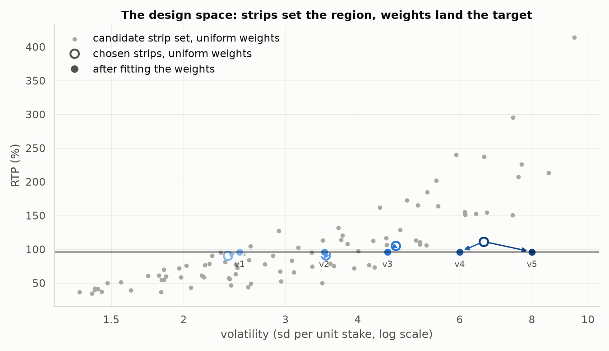
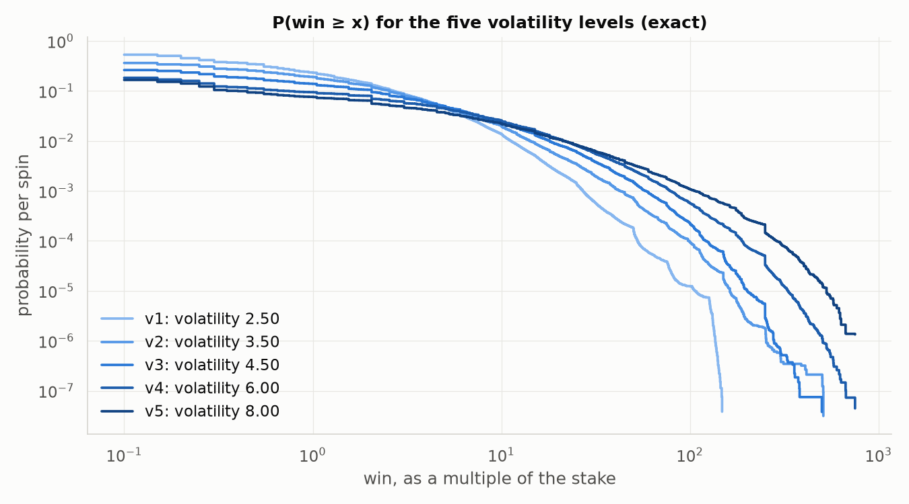

# slot-design

**Play the fitted design:** <https://petkomat.github.io/slot-design/> — the strips and weights
below, spinning in the browser, with the session's RTP and volatility kept next to the target and
the exact value, and a button that spins a million times so they converge while you watch.

**Give it a paytable, the reel geometry, the mechanics, a target RTP and a target volatility; it
fits the reel strips and stop weights that realise them, and proves every design twice:** once
exactly, by enumerating all 32⁵ = 33,554,432 stop combinations in rational arithmetic, and once by
an independent Monte Carlo (10⁹ spins for the main design, 10⁸ for each other level).

The game is a conventional 5×3 video slot: 20 paylines, eight paying symbols, a wild, a scatter,
and cascades with a multiplier ladder. It is fitted at five volatilities from low to high.

| main design: RTP 0.96, volatility 4.5 | |
| --- | --- |
| RTP, exact | **0.9599999943** = 5534023189455385777 / 5764607523034234880 |
| volatility (sd of one spin's payout per unit staked), exact | **4.500804** |
| hit frequency / P(win > stake) | 0.2625 / 0.1302 |
| max win | 500× stake |
| expected cascade steps, per spin / per spin with a line win | 0.32164072 / 1.24981303 |
| Monte Carlo, 10⁹ spins (Numba, 20 threads, 47.9 s) | RTP 0.960084 ± 0.000142 (z = +0.59) |

Full analysis: [`REPORT.md`](REPORT.md) (the main design) and [`VOLATILITY.md`](VOLATILITY.md)
(all five levels). Every number in both is produced by `python -m slotmath.report`.

---

## The game (the inputs)

- **Geometry.** 5 reels × 3 rows, 32 positions per reel, 20 fixed paylines paying left to right.
  The stake is one line bet per line; RTP and win sizes are relative to the whole stake.
- **Symbols.** Three high (`H1`–`H3`), five low (`L1`–`L5`), a wild `W` on reels 2–4 that
  substitutes for every paying symbol, and a scatter `S`, one per reel. No blanks.
- **Cascades.** Winning cells clear, survivors drop, and each reel refills from its own strip.
  Cascade steps 0, 1, 2, 3+ are multiplied by ×1, ×2, ×3, ×5.
- **Scatter.** Counted once, on the window where the cascade chain ends; pays a multiple of the
  stake, unmultiplied.

| line pays (× line bet) | `H1` | `H2` | `H3` | `L1` | `L2` | `L3` | `L4` | `L5` |
| --- | --- | --- | --- | --- | --- | --- | --- | --- |
| 3 of a kind | 25 | 15 | 10 | 5 | 5 | 4 | 3 | 2 |
| 4 of a kind | 100 | 60 | 40 | 20 | 15 | 12 | 10 | 8 |
| 5 of a kind | 500 | 250 | 150 | 100 | 75 | 60 | 50 | 40 |

Scatter: 3, 4 and 5 or more pay 2×, 10× and 50× the stake.

## What is fitted, and how

The paytable is fixed. What is fitted is which symbol sits where on each strip and how likely each
stop is. Stop weights sum to 4096 = 2¹² per reel, so a stop vector's probability is an integer
over 4096⁵ = 2⁶⁰ and every figure below is an exact fraction.

1. **Candidate strips.** A grid of 120 compositions spanned by three knobs: high symbols per reel
   (3 to 17), the height of their stacks (1 to 6) and wilds per reel on reels 2–4 (1 to 3). Each
   composition is laid out by rejection sampling: shuffle until no two blocks of one symbol touch,
   which is exactly uniform over valid layouts.
2. **Exact enumeration.** Cascades refill from the strips, so a spin is a deterministic function
   of its five stops. Every candidate (90 distinct) is enumerated in full, in about 1.5 s each.
3. **Weights.** E[X] and E[X²] are linear in each reel's weights. For each candidate, Gauss–Newton
   steps on the log-weights solve RTP = 0.96 and volatility = target together, taking the
   smallest change from uniform weights, with every weight held within a quarter to four times
   uniform.
4. **Choice and integers.** The candidate needing the smallest weight change wins: the strips
   carry the design, the weights fine-tune it. Weights are rounded to integers and repaired with
   single-unit moves, each priced exactly from the enumeration.

The whole fit, five targets at once, takes about 14 minutes (`python -m slotmath.fit`).



Grey: every candidate strip set under uniform weights. Raising volatility at fixed RTP means moving
return from frequent small wins to rare large ones; the fitter does it with more high symbols in
taller stacks. The arrows are the weights carrying each chosen strip set to its target.

## Results: one game, five volatilities

| level | volatility target | achieved | RTP (exact) | hit frequency | P(win > stake) | max win | strips: high / stack / wilds | Monte Carlo z |
| --- | --- | --- | --- | --- | --- | --- | --- | --- |
| v1 | 2.5 | 2.500093 | 0.9600000003 | 0.533 | 0.219 | 148× | 7 / 1 / 3 | +1.50 |
| v2 | 3.5 | 3.499092 | 0.9600000037 | 0.363 | 0.177 | 509× | 11 / 6 / 3 | +0.33 |
| v3 | 4.5 | 4.500804 | 0.9599999943 | 0.262 | 0.130 | 500× | 15 / 4 / 2 | +1.04 |
| v4 | 6.0 | 6.000366 | 0.9599999971 | 0.184 | 0.090 | 750× | 17 / 6 / 1 | +0.22 |
| v5 | 8.0 | 8.000795 | 0.9600000083 | 0.166 | 0.073 | 750× | 17 / 6 / 1 | −0.73 |

Monte Carlo z is (simulated − exact RTP) / standard error over 10⁸ spins per level. The fitted
strips and weights, and every possible win with its exact probability, are in
[`VOLATILITY.md`](VOLATILITY.md) and `report/wins/`.



**What each mechanic is worth** (main design, fitted weights held fixed, each row its own exact
enumeration):

| configuration | RTP | hit frequency | volatility |
| --- | --- | --- | --- |
| lines only | 35.68% | 13.26% | 2.773 |
| + wilds | 75.68% | 25.74% | 3.863 |
| + cascades | 83.96% | 25.74% | 4.045 |
| + multiplier ladder | 93.78% | 25.74% | 4.490 |
| + scatter (the game) | 96.00% | 26.25% | 4.501 |
| the game with uniform weights | 105.32% | 27.67% | 4.654 |

## How the numbers are verified

The implementation is Numba on 20 threads; the controls are pure Python.

- **Four evaluators, written independently.** `reference.py` states the rules as plainly as
  possible, in pure Python. `exact.py` (Numba) reads each payline once: the leading wilds, then
  the first other symbol, the only one that can run past them. `simulate.py` (Numba) scans each
  line with a shrinking bitmask of the paying symbols it still matches. `web/src/rules.ts`, the
  evaluator behind the playable page, is a fourth, in TypeScript.
- **The two Numba evaluators agree on every stop vector.** On all 33,554,432 stop vectors of every
  fitted design, total pay and cascade length are identical (a test). So the Monte Carlo can only
  differ from the exact figures through the sampling of stops.
- **The sampler is exact by construction.** Each reel has a 4096-entry table in which stop t
  appears exactly its weight times; 12 random bits pick an entry, and one 64-bit splitmix64 draw
  supplies all five reels. Sessions run in parallel on independent streams, so results are
  identical whatever the thread count.
- **The pure-Python control** replays a Numba session's random stream through the reference rules
  and reproduces its totals bit for bit, for the main design and for every volatility level. It
  also matches the Numba enumerator histogram for histogram on small games with wilds, scatters
  and cascades each switched on and off.
- **The browser agrees with Python, exactly.** `slotmath/webfixture.py` records what one seeded
  stream pays under `reference.py`; the TypeScript redraws the same stops from the same seed and
  must reproduce the totals — pay, sum of squares, hits and the cascade-step histogram — spin for
  spin, over a million spins. Not within a tolerance: comparing an empirical RTP against 0.96
  instead would have a standard error of 0.0045 at that many spins, blind to anything under
  about 1% of RTP and failing by chance one run in twenty.
- **The fitter only proposes.** Every reported figure is recomputed from the integer weights in
  exact rational arithmetic.
- **Exact against Monte Carlo.** In the report's run of 10⁹ spins, 11 of 14 comparisons (RTP, hit
  frequency, cascade lengths, big-win probabilities) fall within |z| < 2; the largest, P(D = 4)
  (exactly four winning windows in one spin) at z = +2.98, comes out at +0.05 and +0.07 with two
  other seeds. A separate run of 10¹⁰ spins (2,000 sessions × 5 × 10⁶, seed 777, 516 s) puts all
  ten quantities it checks within |z| < 1.8.
- **Tests.** 67, slow ones included, run in about a minute (`pytest -q`).

## What is exact, and what is not

- **Exact:** every probability (an integer over 2⁶⁰), the RTP as a fraction, hit frequency,
  volatility, the cascade-length distribution, and the probability of each of the main design's
  2,523 distinct payouts, and of every other design's (`report/wins/*.csv`).
- **To tolerance:** the targets. Integer weights cannot land RTP on 0.96 exactly; every design is
  within 10⁻⁸ of it (the exact fraction is reported). Volatility is matched within 0.1% of its
  target (the main design: 1.8 × 10⁻⁴ relative).
- **Estimates:** Monte Carlo figures, always reported with standard errors and z-scores.

## Modelling choices and limits

- **Strip-fed refill.** Cleared cells refill from the strip above, so a spin is a function of its
  stops and the game can be enumerated exactly. Refill by fresh random draws, also used in
  practice, makes the state the whole window, and exact analysis needs an absorbing Markov chain
  that is only tractable for small grids; it is not modelled here.
- **Scatter pays only.** No free-spins feature.
- **The paytable is an input I chose,** in a conventional shape: 4 of a kind pays 3–4× and 5 of a
  kind 15–20× the 3-of-a-kind pay. Changing it means refitting.
- **The design space is three knobs.** Within it, volatilities from 2.5 to 8 are reachable at RTP
  0.96; 2 and 10 are not. The top two levels share their strips (the grid's edge, 17 high symbols
  per reel) and differ only in weights.
- **32 positions per reel.** Exact enumeration costs L⁵: 64-position strips would take about 32×
  longer, around 45 s per candidate.

## Repository

| path | what it is |
| --- | --- |
| `slotmath/game.py` | the game: symbols, paylines, paytable, options, fitted designs |
| `slotmath/reference.py` | the rules in plain Python: the control |
| `slotmath/exact.py` | exact enumeration of all stop vectors (Numba) and exact weighting |
| `slotmath/simulate.py` | the Monte Carlo (Numba) and its pure-Python twin |
| `slotmath/fit.py` | the fitter: candidate strips, weight solver, integer polish |
| `slotmath/designs.json` | the five fitted designs (strips, weights, provenance) |
| `slotmath/report.py` | writes `REPORT.md`, `VOLATILITY.md`, `report/figures`, `report/wins` |
| `tests/` | the agreement tests above |
| `.github/workflows/tests.yml` | CI: lint and the fast tests on Python 3.11 and 3.12 on every push; the slow tests on demand |

## Reproduce

```sh
python -m pip install -e ".[dev,report]"
pytest -q                      # 67 tests, about a minute
python -m slotmath.fit         # refit the five designs, about 14 minutes
python -m slotmath.report      # both reports and figures, about 4 minutes, 2.5 x 10^9 spins
```
