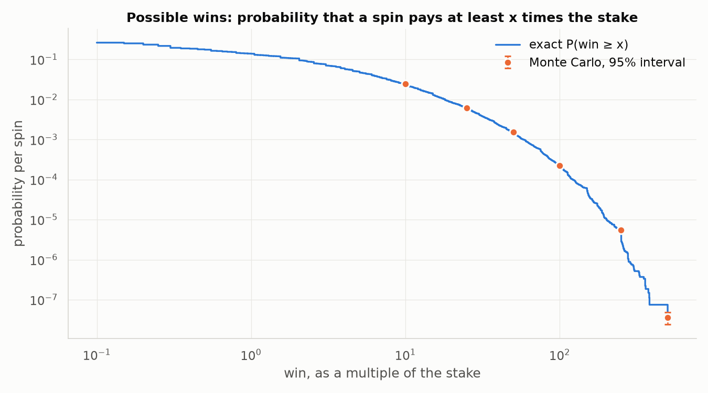
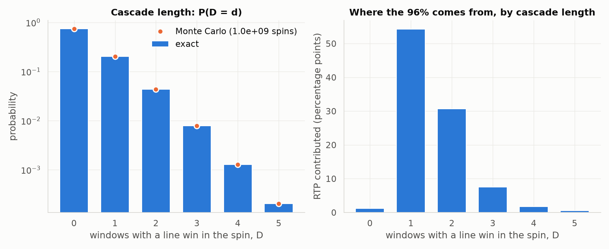
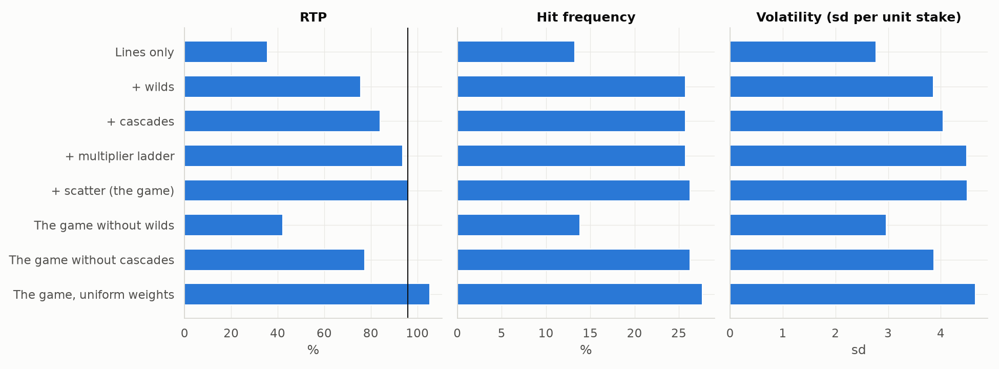
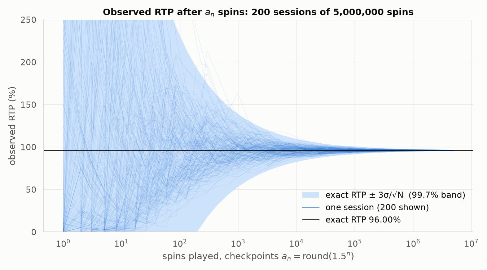
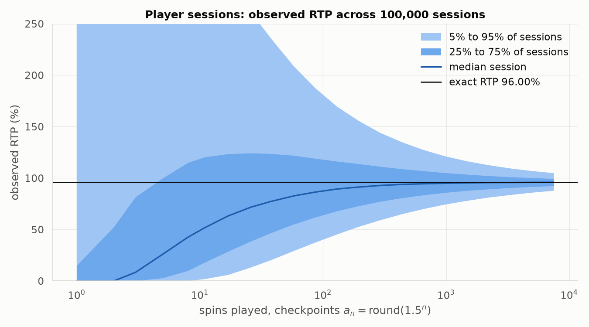
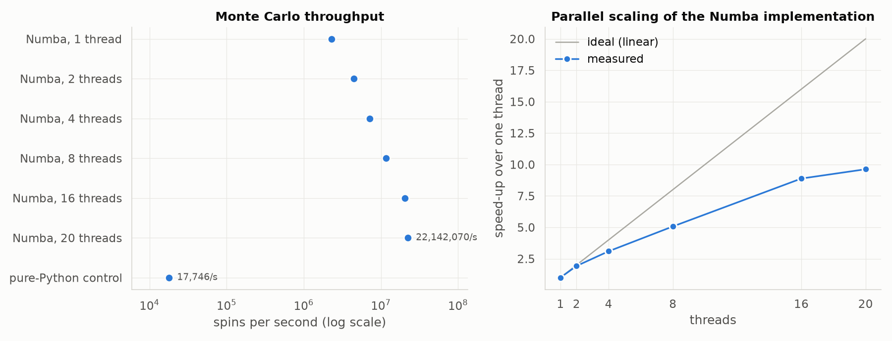

# The fitted 5×3 game: design, exact analysis and Monte Carlo

Generated by `python -m slotmath.report` on 2026-11-03. Every number below comes from that run; nothing is typed in by hand. Machine: 13th Gen Intel(R) Core(TM) i9-13900H, 20 logical cores, Windows 11, Python 3.12.0, NumPy 2.5.4, Numba 0.68.1. The same game fitted to four other volatilities is in [VOLATILITY.md](VOLATILITY.md).

## 1. Game definition (inputs)

- **Geometry.** 5 reels × 3 rows, 32 positions per reel, 20 paylines (`LINES_20` in `slotmath/game.py`), paying left to right from reel 1.
- **Stake.** One line bet per line, 20 line bets a spin. RTP is the expected payout divided by the stake; win sizes are multiples of the whole stake.
- **Symbols.** Eight paying symbols, three high (`H1`–`H3`) and five low (`L1`–`L5`), a wild `W` and a scatter `S`. No blanks: every strip position carries a symbol, as on five-reel video slots.
- **Wilds.** `W` substitutes for every paying symbol on a line; a line of five wilds pays as `H1`. Wilds sit on reels 2–4 only.
- **Cascades (avalanche).** Winning cells clear, survivors drop, and each reel refills from its own strip. Cascade step 0, 1, 2, 3+ is multiplied by ×1, ×2, ×3, ×5.
- **Scatter.** Never part of a line, so never cleared. When the chain ends, the scatters on the final window are counted and pay once, unmultiplied. One scatter per reel.
- **Targets.** RTP = **0.96** and volatility = **4.5**. *Volatility* is the standard deviation of one spin's payout divided by the stake.
- **What is fitted.** The strips (which symbol sits where) and the stop weights, 4096 = 2¹² per reel, each stop between 32 and 512 (a quarter to four times uniform).

**Paytable** (line pays in line bets; the paytable is an input, the same for every design):

| symbol | role | 3 of a kind | 4 of a kind | 5 of a kind |
| --- | --- | --- | --- | --- |
| `H1` | high | 25 | 100 | 500 |
| `H2` | high | 15 | 60 | 250 |
| `H3` | high | 10 | 40 | 150 |
| `L1` | low | 5 | 20 | 100 |
| `L2` | low | 5 | 15 | 75 |
| `L3` | low | 4 | 12 | 60 |
| `L4` | low | 3 | 10 | 50 |
| `L5` | low | 2 | 8 | 40 |
| `W` | wild: substitutes for every paying symbol, no pay of its own | | | |
| `S` | scatter, anywhere: pays × **stake**, not × line bet | 2 | 10 | 50 (5 or more) |

## 2. The fitted game

### 2.1 Reels and weights

**How these were found** (`python -m slotmath.fit`). 90 candidate strip sets were generated from three knobs — high symbols per reel, the height of their stacks, and wilds per reel on reels 2–4 — and each was enumerated exactly. For every candidate the weights hitting both targets were solved by Gauss–Newton (E[X] and E[X²] are linear in each reel's weights), taking the smallest change in log weight from uniform. The candidate whose weights stayed closest to uniform won. The scan took 822 s. Winner: **15 high symbols per reel in stacks of up to 4, 2 wilds on each of reels 2–4** (arrangement seed 1); the solver needed 4 steps, the RMS change in log weight is 0.043, and rounding to integers was repaired by 3 single-unit moves, each priced exactly.

| target | requested | achieved (exact) |
| --- | --- | --- |
| RTP | 0.96 | **0.9599999943** = 5534023189455385777/5764607523034234880 (residual -5.7e-09) |
| volatility | 4.5 | **4.500804** (relative residual +1.8e-04) |

**Composition**: how many of each symbol a reel carries, and in brackets the share of the middle row it fills once the weights are applied.

| symbol | reel 1 | reel 2 | reel 3 | reel 4 | reel 5 |
| --- | --- | --- | --- | --- | --- |
| `H1` | 3 (9.6%) | 3 (9.9%) | 3 (10.0%) | 3 (9.6%) | 3 (9.5%) |
| `H2` | 5 (15.4%) | 5 (16.2%) | 5 (15.3%) | 5 (16.1%) | 5 (16.1%) |
| `H3` | 7 (20.3%) | 7 (21.2%) | 7 (21.4%) | 7 (21.6%) | 7 (21.9%) |
| `L1` | 2 (6.6%) | 2 (6.1%) | 2 (6.1%) | 2 (6.3%) | 2 (6.2%) |
| `L2` | 3 (9.8%) | 3 (9.4%) | 3 (9.8%) | 3 (9.3%) | 3 (9.3%) |
| `L3` | 3 (9.7%) | 3 (9.6%) | 3 (9.5%) | 3 (9.4%) | 3 (9.3%) |
| `L4` | 4 (12.4%) | 3 (9.4%) | 3 (9.3%) | 3 (9.4%) | 4 (12.3%) |
| `L5` | 4 (12.8%) | 3 (9.1%) | 3 (9.9%) | 3 (9.3%) | 4 (12.4%) |
| `W` | – | 2 (5.7%) | 2 (5.6%) | 2 (6.1%) | – |
| `S` | 1 (3.3%) | 1 (3.3%) | 1 (3.0%) | 1 (3.0%) | 1 (3.0%) |
| weight range | 114–136 | 117–137 | 115–138 | 122–135 | 124–136 |

**Strips and weights** (stop t shows positions t, t+1, t+2 in rows 1–3; the probability of stop t is its weight / 4096):

<details><summary>Show the 32 × 5 table</summary>

| stop | reel 1 | weight | reel 2 | weight | reel 3 | weight | reel 4 | weight | reel 5 | weight |
| --- | --- | --- | --- | --- | --- | --- | --- | --- | --- | --- |
| 0 | `L3` | 136 | `L2` | 137 | `H2` | 132 | `L2` | 128 | `L4` | 127 |
| 1 | `L1` | 136 | `L3` | 133 | `L5` | 116 | `L3` | 130 | `H3` | 129 |
| 2 | `L3` | 129 | `L1` | 132 | `L1` | 115 | `H2` | 128 | `H3` | 130 |
| 3 | `L5` | 128 | `H2` | 134 | `W` | 118 | `L3` | 130 | `H3` | 126 |
| 4 | `H2` | 128 | `H2` | 135 | `H2` | 130 | `L1` | 129 | `H3` | 124 |
| 5 | `L5` | 133 | `H2` | 133 | `H2` | 130 | `L4` | 127 | `S` | 125 |
| 6 | `L1` | 131 | `H2` | 130 | `H2` | 118 | `L1` | 126 | `L4` | 127 |
| 7 | `L2` | 130 | `L4` | 133 | `H2` | 116 | `H3` | 127 | `L2` | 130 |
| 8 | `H1` | 132 | `H1` | 136 | `W` | 117 | `H3` | 127 | `H2` | 135 |
| 9 | `H1` | 131 | `H1` | 135 | `L4` | 123 | `H3` | 126 | `H2` | 136 |
| 10 | `H1` | 131 | `H1` | 120 | `S` | 122 | `H3` | 127 | `H2` | 132 |
| 11 | `L5` | 136 | `L3` | 117 | `H3` | 126 | `L5` | 129 | `H2` | 128 |
| 12 | `L2` | 136 | `W` | 121 | `H3` | 126 | `L2` | 129 | `L1` | 127 |
| 13 | `L5` | 126 | `L5` | 127 | `H3` | 125 | `L5` | 129 | `L3` | 127 |
| 14 | `L3` | 121 | `L2` | 130 | `H3` | 128 | `L4` | 131 | `L4` | 126 |
| 15 | `H3` | 120 | `H2` | 124 | `L2` | 134 | `H1` | 133 | `L2` | 126 |
| 16 | `H3` | 120 | `L2` | 124 | `L4` | 136 | `H1` | 128 | `L4` | 126 |
| 17 | `H3` | 114 | `H3` | 124 | `L3` | 138 | `H1` | 122 | `L3` | 126 |
| 18 | `H3` | 116 | `H3` | 125 | `L5` | 137 | `S` | 123 | `L5` | 127 |
| 19 | `H2` | 130 | `H3` | 129 | `L2` | 133 | `W` | 124 | `H3` | 129 |
| 20 | `H2` | 130 | `L4` | 118 | `L1` | 135 | `L2` | 129 | `H3` | 128 |
| 21 | `H2` | 128 | `L5` | 117 | `H1` | 138 | `L3` | 129 | `H3` | 129 |
| 22 | `H2` | 118 | `W` | 117 | `H1` | 135 | `L4` | 126 | `H1` | 132 |
| 23 | `L4` | 118 | `L1` | 123 | `H1` | 127 | `L5` | 126 | `H1` | 129 |
| 24 | `H3` | 120 | `H3` | 124 | `L3` | 126 | `H3` | 127 | `H1` | 127 |
| 25 | `H3` | 120 | `H3` | 124 | `H3` | 127 | `H3` | 124 | `L1` | 127 |
| 26 | `H3` | 121 | `H3` | 125 | `H3` | 126 | `H3` | 125 | `L5` | 127 |
| 27 | `L4` | 135 | `H3` | 127 | `H3` | 128 | `W` | 128 | `L3` | 128 |
| 28 | `L2` | 135 | `L4` | 135 | `L3` | 136 | `H2` | 134 | `H2` | 127 |
| 29 | `L4` | 136 | `S` | 135 | `L5` | 137 | `H2` | 135 | `L5` | 127 |
| 30 | `S` | 135 | `L5` | 136 | `L2` | 130 | `H2` | 132 | `L2` | 126 |
| 31 | `L4` | 136 | `L3` | 136 | `L4` | 131 | `H2` | 128 | `L5` | 126 |

</details>

### 2.2 Possible wins

All 32⁵ = 33,554,432 stop vectors were evaluated by the Numba enumerator in **1.30 s** on 20 threads and the weights applied in 0.59 s. Cascades refill from the strips, so a spin is a function of its stops, and every probability below is exact: an integer over 4096⁵ = 2⁶⁰.

| quantity | exact value |
| --- | --- |
| RTP | 0.9599999943 |
| of which: first window's line wins | 0.756829 |
| of which: cascades (steps 1 and later, multipliers included) | 0.180988 |
| of which: scatter | 0.022183 |
| hit frequency (any payout) | 0.262456 (1 in 3.8) |
| P(win > stake) | 0.130218 (1 in 7.7) |
| volatility (sd per unit stake) | 4.5008 |
| max win | 500.00× stake |
| distinct payout values | 2,523 |
| runaway cascades (chains of 100) | 0 |

With uniform weights the same strips pay 105.32% at volatility 4.654; the weights move the game to its targets.

The 2,523 payout values, grouped by size (every value with its exact probability is in [report/wins/v3.csv](report/wins/v3.csv)):

| win (× stake) | probability | frequency | share of RTP | distinct values |
| --- | --- | --- | --- | --- |
| 0 (no win) | 7.375438e-01 | 1 in 1.4 | 0.00% | 1 |
| below the stake | 1.236594e-01 | 1 in 8.1 | 4.37% | 18 |
| exactly the stake | 8.579150e-03 | 1 in 117 | 0.86% | 1 |
| 1–2× | 2.458292e-02 | 1 in 41 | 3.50% | 19 |
| 2–5× | 5.582975e-02 | 1 in 18 | 16.51% | 60 |
| 5–10× | 2.552340e-02 | 1 in 39 | 17.43% | 100 |
| 10–20× | 1.572826e-02 | 1 in 64 | 21.28% | 200 |
| 20–50× | 7.002122e-03 | 1 in 143 | 20.53% | 579 |
| 50–100× | 1.324511e-03 | 1 in 755 | 8.56% | 794 |
| 100–250× | 2.212666e-04 | 1 in 4,519 | 2.83% | 703 |
| 250–500× | 5.448926e-06 | 1 in 183,522 | 0.15% | 47 |
| 500–1,000× | 3.772400e-08 | 1 in 26,508,322 | 0.00% | 1 |



### 2.3 Cascade analysis

Let **D** be the number of windows with a line win in a spin: 0 when the lines pay nothing (a scatter can still pay), 1 for a win whose refill pays nothing, and so on. A spin with D = d contains d − 1 paying cascades.

| quantity | exact |
| --- | --- |
| E[D] per spin | **0.32164072** |
| E[D \| D ≥ 1], per spin with a line win | **1.24981303** |
| E[paying cascades \| D ≥ 1] = E[D \| D ≥ 1] − 1 | 0.24981303 |
| check: Σ_d P(D ≥ d) | 0.32164072 (equals E[D] exactly: True) |

| D | P(D = d) | P(D ≥ d) | RTP contributed |
| --- | --- | --- | --- |
| 0 | 0.74264893 | 1.00000000 | 1.220% |
| 1 | 0.20419076 | 0.25735107 | 54.231% |
| 2 | 0.04372631 | 0.05316030 | 30.706% |
| 3 | 0.00794351 | 0.00943400 | 7.579% |
| 4 | 0.00128562 | 0.00149048 | 1.770% |
| 5 | 0.00020486 | 0.00020486 | 0.495% |



### 2.4 What each mechanic is worth

Each configuration is its own exact enumeration with the fitted weights held fixed, so the table shows what each mechanic adds, not a refitted game.

| configuration | RTP | hit frequency | volatility | E[D] | max win | enumeration |
| --- | --- | --- | --- | --- | --- | --- |
| Lines only | 35.68% | 13.26% | 2.773 | 0.1326 | 500.0× | 1.12 s |
| + wilds | 75.68% | 25.74% | 3.863 | 0.2574 | 500.0× | 1.12 s |
| + cascades | 83.96% | 25.74% | 4.045 | 0.3216 | 500.0× | 1.42 s |
| + multiplier ladder | 93.78% | 25.74% | 4.490 | 0.3216 | 500.0× | 1.37 s |
| + scatter (the game) | 96.00% | 26.25% | 4.501 | 0.3216 | 500.0× | reused |
| The game without wilds | 42.17% | 13.84% | 2.965 | 0.1553 | 500.0× | 1.21 s |
| The game without cascades | 77.40% | 26.25% | 3.870 | 0.2574 | 500.0× | 1.07 s |
| The game, uniform weights | 105.32% | 27.67% | 4.654 | 0.3403 | 500.0× | reused |



## 3. Monte Carlo

The Monte Carlo implementation (Numba, `slotmath/simulate.py`, an evaluator written independently of the exact path) simulated **200 sessions × 5,000,000 spins = 1,000,000,000 spins in 47.9 s on 20 threads** (20.9 million spins per second; master seed 2026, one splitmix64 stream per session). Rows whose expected count is below 10 are left out.

| quantity | exact | Monte Carlo | standard error | z |
| --- | --- | --- | --- | --- |
| RTP | 0.960000 | 0.960084 | 0.000142 | +0.59 |
| hit frequency | 0.262456 | 0.262472 | 0.000014 | +1.11 |
| E[D] | 0.321641 | 0.321674 | 0.000019 | +1.70 |
| P(D = 1) | 2.042e-01 | 2.042e-01 | 1.3e-05 | +0.70 |
| P(D = 2) | 4.373e-02 | 4.372e-02 | 6.5e-06 | -0.27 |
| P(D = 3) | 7.944e-03 | 7.949e-03 | 2.8e-06 | +2.02 |
| P(D = 4) | 1.286e-03 | 1.289e-03 | 1.1e-06 | +2.98 |
| P(D = 5) | 2.049e-04 | 2.042e-04 | 4.5e-07 | -1.40 |
| P(win ≥ 10×) | 2.428e-02 | 2.429e-02 | 4.9e-06 | +1.45 |
| P(win ≥ 25×) | 6.196e-03 | 6.191e-03 | 2.5e-06 | -2.09 |
| P(win ≥ 50×) | 1.551e-03 | 1.551e-03 | 1.2e-06 | -0.45 |
| P(win ≥ 100×) | 2.268e-04 | 2.267e-04 | 4.8e-07 | -0.14 |
| P(win ≥ 250×) | 5.487e-06 | 5.500e-06 | 7.4e-08 | +0.18 |
| P(win ≥ 500×) | 3.772e-08 | 3.600e-08 | 6.1e-09 | -0.28 |
| volatility | 4.5008 | 4.5012 | | |

Runaway cascades observed: 0.

### Observed RTP after aₙ = round(1.5ⁿ) spins

Each session records its running RTP at the checkpoints aₙ = round(1.5ⁿ), n ≥ 0 (1, 2, 3, 5, 8, 11, 17, 26, 38, …; a₁ = a₂ = 2, so the duplicate is dropped). The band is the exact RTP ± 3σ/√N with σ the exact volatility, the 99.7% range a correctly built game should stay inside once N is large enough for the normal approximation. Values outside the plotted range are clipped.

| spins N | 3σ/√N | sessions inside the band | session RTP, min | median | max |
| --- | --- | --- | --- | --- | --- |
| 1 | 1350.24% | 96.5% | 0.00% | 0.00% | 3000.00% |
| 11 | 407.11% | 95.0% | 0.00% | 51.14% | 1199.09% |
| 86 | 145.60% | 99.0% | 18.84% | 89.36% | 403.66% |
| 985 | 43.02% | 99.5% | 64.77% | 96.18% | 163.87% |
| 11,223 | 12.75% | 99.5% | 87.43% | 96.44% | 110.29% |
| 85,223 | 4.63% | 99.0% | 91.13% | 96.00% | 100.75% |
| 970,740 | 1.37% | 100.0% | 95.07% | 96.05% | 97.15% |
| 4,914,370 | 0.61% | 100.0% | 95.54% | 96.02% | 96.44% |



### Player sessions

100,000 independent sessions of 10,000 spins (1,000,000,000 spins, Numba, 49.4 s on 20 threads): the spread of observed RTP a player sees, and how often a session ends ahead.

| spins N | 5% | 25% | median | 75% | 95% | sessions ahead (RTP ≥ 100%) |
| --- | --- | --- | --- | --- | --- | --- |
| 1 | 0.0% | 0.0% | 0.0% | 15.0% | 480.0% | 14.1% |
| 11 | 1.8% | 18.2% | 51.8% | 120.5% | 333.6% | 30.4% |
| 86 | 37.2% | 61.8% | 86.3% | 119.1% | 187.7% | 38.1% |
| 985 | 74.3% | 85.9% | 95.0% | 105.1% | 121.1% | 36.6% |
| 7,482 | 87.7% | 92.4% | 95.9% | 99.5% | 104.8% | 21.9% |



## 4. How the numbers are checked

The implementation is Numba: the exact enumerator (`slotmath/exact.py`) and the Monte Carlo (`slotmath/simulate.py`), two evaluators written independently of each other. The controls are pure Python.

- **Control: the rules.** `slotmath/reference.py` states the rules as plainly as possible. It reproduces a hand-checkable three-reel game exactly (RTP 43637/12800). The Numba enumerator matches its enumeration histogram for histogram on small games with wilds, scatters and cascades each on and off, and the Numba Monte Carlo evaluator matches it on thousands of random spins.
- **Control: the session.** The pure-Python session replays a Numba session's random stream through the reference rules. In this run, on 50,000 spins of this game, it reproduced the Numba session's totals bit for bit.
- **The two Numba evaluators agree on every one of the 33,554,432 stop vectors** of every fitted game, total pay and chain length alike. So the only thing separating the Monte Carlo from the exact figures is the sampling of stops, and the sampler is tested exactly (each stop appears in its lookup table exactly its weight times).
- **The fitter only proposes** weights; every reported figure is recomputed from the integer weights in exact rational arithmetic.
- **Statistics.** The exact figures and the Monte Carlo then agree within sampling error, as tabled in §3.

Reproduce:

```sh
python -m pip install -e ".[dev,report]"
pytest -q
python -m slotmath.fit       # strips and weights -> slotmath/designs.json
python -m slotmath.report    # REPORT.md and VOLATILITY.md
```

## 5. Speed: the Numba implementation against the pure-Python control

Every figure above comes from the Numba implementation on 20 threads. The control evaluates **17,746 spins per second** (measured in this run: 50,000 spins in 2.82 s). Its times for the full workloads are extrapolated from that rate, not run.

| task | Numba, measured | pure-Python control, extrapolated | speed-up |
| --- | --- | --- | --- |
| Monte Carlo, long sessions (1,000,000,000 spins) | 47.9 s | 15.7 h | 1,177× |
| Monte Carlo, player sessions (1,000,000,000 spins) | 49.4 s | 15.7 h | 1,141× |
| exact enumeration (33,554,432 stop vectors) | 1.3 s | 32 min | 1,456× |

**Thread scaling** (Numba Monte Carlo, 9,600,000 spins per run in 240 sessions):

| threads | seconds | spins per second | against one thread | against the control |
| --- | --- | --- | --- | --- |
| 1 | 4.17 | 2,300,709 | 1.0× | 130× |
| 2 | 2.17 | 4,425,868 | 1.9× | 249× |
| 4 | 1.35 | 7,120,994 | 3.1× | 401× |
| 8 | 0.82 | 11,666,900 | 5.1× | 657× |
| 16 | 0.47 | 20,438,504 | 8.9× | 1,152× |
| 20 | 0.43 | 22,142,070 | 9.6× | 1,248× |

Exact enumeration of all 33,554,432 stop vectors: 9.2 s on one thread, 1.34 s on 20 threads. Scaling depends on the machine: on a hybrid processor, threads beyond the performance cores, and hyper-threads sharing a core, add less than a full core each.

What makes the Numba implementation fast:

- **One random number per spin.** Weights sum to 4096 = 2¹² per reel, so a reel's stop is 12 random bits looked up in a 4096-entry table (no search, no modulo bias), and one 64-bit splitmix64 draw covers all five reels.
- **One pass per payline.** A line is read once, left to right, with a shrinking bitmask of the paying symbols it still matches; the wild matches all of them.
- **No allocation in the spin loop.** Each session owns its scratch arrays; a spin touches only small integer arrays and a 64-bit mask of winning cells.
- **Independent streams.** Sessions run in parallel, each seeded from the master seed and its index, so the result is bit-for-bit identical whatever the thread count.


