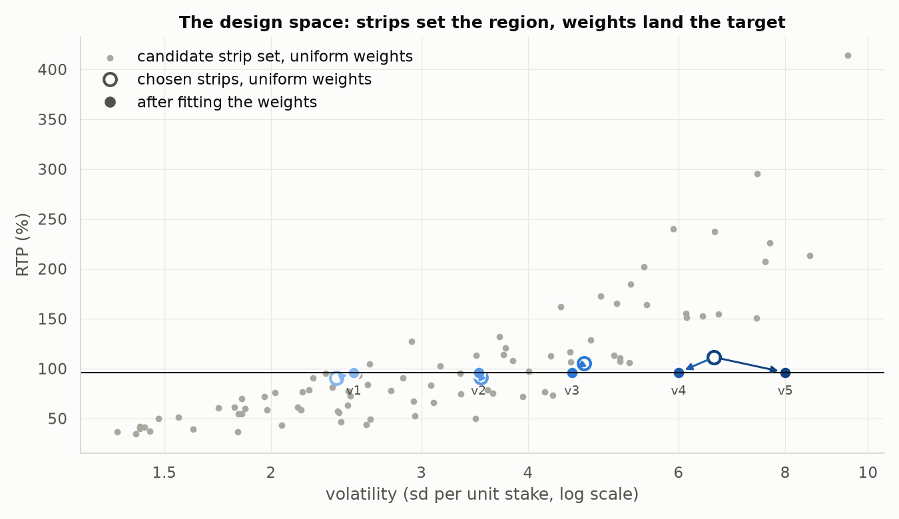
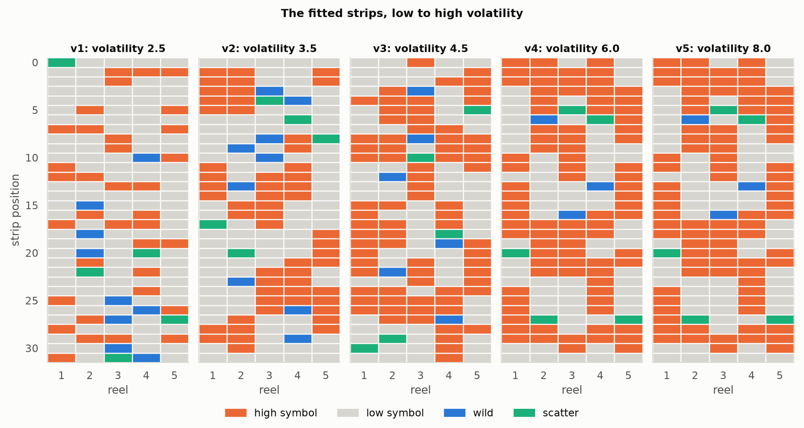
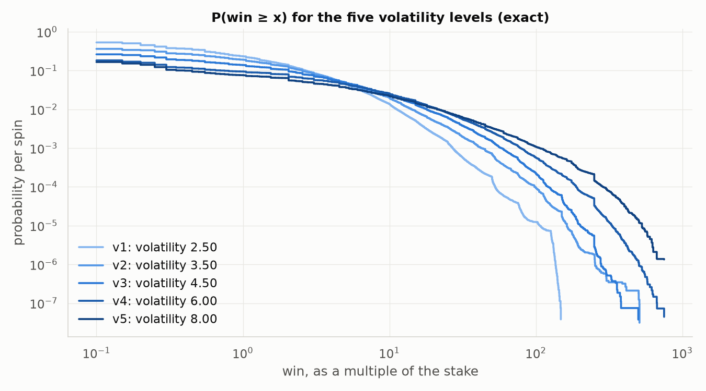

# One game, five volatilities

Generated by `python -m slotmath.report` on 2026-11-03, alongside [REPORT.md](REPORT.md), which analyses level v3 in depth. Every number comes from that run. Machine: 13th Gen Intel(R) Core(TM) i9-13900H, 20 logical cores, Windows 11, Python 3.12.0, NumPy 2.5.4, Numba 0.68.1.

## 1. Game definition (inputs)

Everything is held fixed except the volatility target: the same paytable, reels, mechanics and RTP, refitted five times.

- **Geometry.** 5 reels × 3 rows, 32 positions per reel, 20 paylines (`LINES_20` in `slotmath/game.py`), paying left to right from reel 1.
- **Stake.** One line bet per line, 20 line bets a spin. RTP is the expected payout divided by the stake; win sizes are multiples of the whole stake.
- **Symbols.** Eight paying symbols, three high (`H1`–`H3`) and five low (`L1`–`L5`), a wild `W` and a scatter `S`. No blanks: every strip position carries a symbol, as on five-reel video slots.
- **Wilds.** `W` substitutes for every paying symbol on a line; a line of five wilds pays as `H1`. Wilds sit on reels 2–4 only.
- **Cascades (avalanche).** Winning cells clear, survivors drop, and each reel refills from its own strip. Cascade step 0, 1, 2, 3+ is multiplied by ×1, ×2, ×3, ×5.
- **Scatter.** Never part of a line, so never cleared. When the chain ends, the scatters on the final window are counted and pay once, unmultiplied. One scatter per reel.
- **Targets.** RTP = **0.96** and volatility ∈ {2.5, 3.5, 4.5, 6.0, 8.0}, levels v1 to v5. *Volatility* is the standard deviation of one spin's payout divided by the stake.
- **What is fitted.** The strips (which symbol sits where) and the stop weights, 4096 = 2¹² per reel, each stop between 32 and 512 (a quarter to four times uniform).

**Paytable** (line pays in line bets; the paytable is an input, the same for every design):

| symbol | role | 3 of a kind | 4 of a kind | 5 of a kind |
| --- | --- | --- | --- | --- |
| `H1` | high | 25 | 100 | 500 |
| `H2` | high | 15 | 60 | 250 |
| `H3` | high | 10 | 40 | 150 |
| `L1` | low | 5 | 20 | 100 |
| `L2` | low | 5 | 15 | 75 |
| `L3` | low | 4 | 12 | 60 |
| `L4` | low | 3 | 10 | 50 |
| `L5` | low | 2 | 8 | 40 |
| `W` | wild: substitutes for every paying symbol, no pay of its own | | | |
| `S` | scatter, anywhere: pays × **stake**, not × line bet | 2 | 10 | 50 (5 or more) |

**The fitting procedure** (`python -m slotmath.fit`, the same for every level):

1. **Strips.** 90 candidate strip sets from three knobs: high symbols per reel [3, 5, 7, 9, 11, 13, 15, 17], stack height [1, 2, 3, 4, 6], wilds on each of reels 2–4 [1, 2, 3]. Low symbols fill the rest. Each set is enumerated exactly once.
2. **Weights.** For every candidate and every target, Gauss–Newton steps solve RTP = 0.96 and volatility = target at once, each step taking the smallest change in log weight from uniform. Both E[X] and E[X²] are linear in each reel's weights, so the derivatives are exact.
3. **Choice.** Among the candidates that reach a target within the weight bounds, the one whose weights stay closest to uniform wins.
4. **Integers.** Weights are rounded to integers and polished with single-unit moves, each priced exactly; the result is verified in exact rational arithmetic.

The scan took 822 s for all 5 targets at once.

Each grey dot is a candidate strip set under uniform weights. Raising volatility at a fixed RTP means moving return from frequent small wins to rare large ones: more high symbols, in taller stacks, with fewer low symbols. The arrows show the weights carrying each chosen strip set to RTP 96% and its volatility target.

## 2. Results for each volatility

| level | volatility target | achieved | RTP (exact) | hit frequency | P(win > stake) | max win | E[D] | strips: high / stack / wilds | weight change (RMS log) | Monte Carlo RTP (z) | Monte Carlo volatility |
| --- | --- | --- | --- | --- | --- | --- | --- | --- | --- | --- | --- |
| v1 | 2.5 | 2.500093 | 0.9600000003 | 0.5326 | 0.2187 | 147.9× | 0.8315 | 7 / 1 / 3 | 0.031 | 0.9604 (+1.50) | 2.502 |
| v2 | 3.5 | 3.499092 | 0.9600000037 | 0.3633 | 0.1774 | 509.4× | 0.5272 | 11 / 6 / 3 | 0.036 | 0.9601 (+0.33) | 3.501 |
| v3 | 4.5 | 4.500804 | 0.9599999943 | 0.2625 | 0.1302 | 500.0× | 0.3216 | 15 / 4 / 2 | 0.043 | 0.9605 (+1.04) | 4.503 |
| v4 | 6.0 | 6.000366 | 0.9599999971 | 0.1836 | 0.0901 | 750.0× | 0.2309 | 17 / 6 / 1 | 0.049 | 0.9601 (+0.22) | 5.999 |
| v5 | 8.0 | 8.000795 | 0.9600000083 | 0.1664 | 0.0725 | 750.0× | 0.2082 | 17 / 6 / 1 | 0.201 | 0.9594 (-0.73) | 7.993 |

Monte Carlo: 100,000,000 spins per level, Numba on 20 threads, 4.6–7.2 s per level. The z-score is (simulated − exact) / standard error.

**Possible wins, by size** (probability per spin, exact):

| win (× stake) | v1 | v2 | v3 | v4 | v5 |
| --- | --- | --- | --- | --- | --- |
| 0 (no win) | 4.674e-01 | 6.367e-01 | 7.375e-01 | 8.164e-01 | 8.336e-01 |
| below the stake | 3.007e-01 | 1.733e-01 | 1.237e-01 | 8.937e-02 | 9.067e-02 |
| exactly the stake | 1.316e-02 | 1.262e-02 | 8.579e-03 | 4.090e-03 | 3.256e-03 |
| 1–2× | 7.726e-02 | 4.955e-02 | 2.458e-02 | 1.007e-02 | 8.210e-03 |
| 2–5× | 9.406e-02 | 7.800e-02 | 5.583e-02 | 3.475e-02 | 2.703e-02 |
| 5–10× | 3.356e-02 | 2.946e-02 | 2.552e-02 | 1.966e-02 | 1.481e-02 |
| 10–20× | 1.139e-02 | 1.523e-02 | 1.573e-02 | 1.449e-02 | 1.156e-02 |
| 20–50× | 2.207e-03 | 4.430e-03 | 7.002e-03 | 8.548e-03 | 7.539e-03 |
| 50–100× | 1.715e-04 | 6.358e-04 | 1.325e-03 | 2.058e-03 | 2.265e-03 |
| 100–250× | 1.241e-05 | 9.478e-05 | 2.213e-04 | 5.202e-04 | 8.779e-04 |
| 250–500× | – | 1.570e-06 | 5.449e-06 | 4.915e-05 | 1.973e-04 |
| 500–1,000× | – | 1.828e-07 | 3.772e-08 | 1.216e-06 | 1.400e-05 |

Levels v4 and v5 landed on the same strip set, the least-distorted candidate for both targets; only their weights differ. The grid's upper edge (at most 17 high symbols per reel) is what limits the top of the range.

### v1: volatility 2.5

7 high symbols per reel in stacks of up to 1, 3 wilds on each of reels 2–4. Exact RTP 0.9600000003, volatility 2.500093, hit frequency 0.5326, max win 147.9×, 1,754 distinct payouts; weights within 123–159 after 4 polishing moves.

Reels and weights

| symbol | reel 1 | reel 2 | reel 3 | reel 4 | reel 5 |
| --- | --- | --- | --- | --- | --- |
| `H1` | 2 (6.3%) | 2 (6.1%) | 2 (6.2%) | 2 (6.3%) | 2 (6.5%) |
| `H2` | 2 (6.4%) | 2 (6.2%) | 2 (6.2%) | 2 (6.2%) | 2 (6.2%) |
| `H3` | 3 (9.4%) | 3 (9.2%) | 3 (10.0%) | 3 (9.4%) | 3 (9.3%) |
| `L1` | 4 (12.4%) | 3 (9.3%) | 3 (9.3%) | 3 (9.3%) | 4 (12.5%) |
| `L2` | 4 (12.4%) | 4 (12.8%) | 4 (12.4%) | 4 (12.4%) | 4 (12.5%) |
| `L3` | 5 (15.6%) | 4 (12.3%) | 4 (12.4%) | 4 (12.7%) | 5 (15.7%) |
| `L4` | 5 (15.5%) | 5 (15.4%) | 5 (15.5%) | 5 (15.4%) | 5 (15.5%) |
| `L5` | 6 (18.8%) | 5 (15.5%) | 5 (15.5%) | 5 (15.6%) | 6 (18.6%) |
| `W` | – | 3 (10.2%) | 3 (9.6%) | 3 (9.6%) | – |
| `S` | 1 (3.2%) | 1 (3.1%) | 1 (3.1%) | 1 (3.1%) | 1 (3.2%) |
| weight range | 123–132 | 124–151 | 123–159 | 123–132 | 126–133 |

| stop | reel 1 | weight | reel 2 | weight | reel 3 | weight | reel 4 | weight | reel 5 | weight |
| --- | --- | --- | --- | --- | --- | --- | --- | --- | --- | --- |
| 0 | `S` | 130 | `L1` | 127 | `L1` | 126 | `L3` | 130 | `L5` | 128 |
| 1 | `L2` | 126 | `L4` | 125 | `H2` | 126 | `H3` | 127 | `H3` | 129 |
| 2 | `L4` | 126 | `L3` | 129 | `H1` | 125 | `L4` | 125 | `L2` | 126 |
| 3 | `L1` | 123 | `L1` | 125 | `L4` | 125 | `L2` | 125 | `L5` | 127 |
| 4 | `L3` | 123 | `L5` | 126 | `L5` | 128 | `L5` | 125 | `L4` | 127 |
| 5 | `L2` | 126 | `H1` | 126 | `L4` | 132 | `L1` | 123 | `H3` | 129 |
| 6 | `L4` | 130 | `L2` | 126 | `L2` | 125 | `L4` | 127 | `L1` | 128 |
| 7 | `H2` | 131 | `H3` | 127 | `L3` | 126 | `L1` | 125 | `H2` | 128 |
| 8 | `L5` | 129 | `L4` | 127 | `H2` | 128 | `L2` | 129 | `L3` | 128 |
| 9 | `L3` | 128 | `L3` | 127 | `H1` | 128 | `L5` | 132 | `L1` | 133 |
| 10 | `L5` | 130 | `L2` | 125 | `L1` | 132 | `W` | 131 | `H1` | 133 |
| 11 | `H3` | 131 | `L5` | 125 | `L4` | 126 | `L3` | 131 | `L3` | 127 |
| 12 | `H1` | 128 | `H1` | 126 | `L2` | 126 | `L5` | 129 | `L5` | 127 |
| 13 | `L3` | 131 | `L3` | 127 | `H3` | 123 | `H1` | 128 | `L3` | 127 |
| 14 | `L5` | 127 | `L1` | 129 | `L3` | 124 | `L1` | 127 | `L4` | 127 |
| 15 | `L4` | 130 | `W` | 125 | `L4` | 124 | `L5` | 127 | `L2` | 127 |
| 16 | `L5` | 125 | `H2` | 133 | `L2` | 124 | `H2` | 128 | `L1` | 127 |
| 17 | `H3` | 126 | `L5` | 138 | `H3` | 125 | `H3` | 127 | `L3` | 127 |
| 18 | `L4` | 124 | `W` | 147 | `L1` | 125 | `L2` | 126 | `L4` | 128 |
| 19 | `L1` | 125 | `L2` | 151 | `L5` | 127 | `H2` | 126 | `H2` | 129 |
| 20 | `L5` | 127 | `W` | 128 | `L3` | 127 | `S` | 127 | `L2` | 126 |
| 21 | `L1` | 127 | `H2` | 128 | `L5` | 125 | `L4` | 128 | `L4` | 126 |
| 22 | `L2` | 127 | `S` | 126 | `L4` | 124 | `H1` | 128 | `L5` | 127 |
| 23 | `L5` | 129 | `L4` | 125 | `L5` | 126 | `L4` | 127 | `L2` | 126 |
| 24 | `L3` | 128 | `L5` | 124 | `L2` | 125 | `H3` | 130 | `L5` | 129 |
| 25 | `H3` | 129 | `L3` | 124 | `W` | 132 | `L3` | 131 | `L4` | 132 |
| 26 | `L2` | 130 | `L4` | 125 | `L3` | 134 | `W` | 130 | `H1` | 132 |
| 27 | `L4` | 132 | `H3` | 125 | `W` | 132 | `L3` | 129 | `S` | 127 |
| 28 | `H2` | 128 | `L4` | 124 | `L5` | 159 | `L5` | 126 | `L3` | 127 |
| 29 | `L3` | 129 | `H3` | 124 | `H3` | 134 | `L4` | 130 | `H3` | 128 |
| 30 | `L1` | 129 | `L2` | 126 | `W` | 127 | `L2` | 131 | `L5` | 127 |
| 31 | `H1` | 132 | `L5` | 126 | `S` | 126 | `W` | 131 | `L1` | 127 |

Possible wins (every value with its exact probability: [report/wins/v1.csv](report/wins/v1.csv)):

| win (× stake) | probability | frequency | share of RTP | distinct values |
| --- | --- | --- | --- | --- |
| 0 (no win) | 4.674449e-01 | 1 in 2.1 | 0.00% | 1 |
| below the stake | 3.007403e-01 | 1 in 3.3 | 11.21% | 18 |
| exactly the stake | 1.315921e-02 | 1 in 76 | 1.32% | 1 |
| 1–2× | 7.725528e-02 | 1 in 13 | 10.96% | 19 |
| 2–5× | 9.405507e-02 | 1 in 11 | 28.20% | 60 |
| 5–10× | 3.356213e-02 | 1 in 30 | 22.41% | 100 |
| 10–20× | 1.139219e-02 | 1 in 88 | 14.83% | 200 |
| 20–50× | 2.206930e-03 | 1 in 453 | 5.94% | 598 |
| 50–100× | 1.715350e-04 | 1 in 5,830 | 1.00% | 590 |
| 100–250× | 1.240502e-05 | 1 in 80,613 | 0.15% | 167 |

### v2: volatility 3.5

11 high symbols per reel in stacks of up to 6, 3 wilds on each of reels 2–4. Exact RTP 0.9600000037, volatility 3.499092, hit frequency 0.3633, max win 509.4×, 2,467 distinct payouts; weights within 120–144 after 14 polishing moves.

Reels and weights

| symbol | reel 1 | reel 2 | reel 3 | reel 4 | reel 5 |
| --- | --- | --- | --- | --- | --- |
| `H1` | 2 (6.3%) | 2 (6.1%) | 2 (6.1%) | 2 (6.2%) | 2 (6.2%) |
| `H2` | 4 (12.4%) | 4 (11.9%) | 4 (12.0%) | 4 (12.1%) | 4 (12.1%) |
| `H3` | 5 (15.6%) | 5 (15.0%) | 5 (15.0%) | 5 (15.4%) | 5 (15.3%) |
| `L1` | 3 (9.4%) | 3 (9.1%) | 3 (9.1%) | 3 (9.5%) | 3 (9.7%) |
| `L2` | 3 (9.4%) | 3 (9.2%) | 3 (9.6%) | 3 (9.4%) | 3 (9.5%) |
| `L3` | 4 (12.5%) | 3 (9.3%) | 3 (9.2%) | 3 (9.5%) | 4 (12.6%) |
| `L4` | 5 (15.7%) | 4 (13.3%) | 4 (13.0%) | 4 (12.7%) | 5 (15.8%) |
| `L5` | 5 (15.6%) | 4 (12.9%) | 4 (12.5%) | 4 (12.6%) | 5 (15.6%) |
| `W` | – | 3 (10.2%) | 3 (10.3%) | 3 (9.4%) | – |
| `S` | 1 (3.1%) | 1 (3.0%) | 1 (3.4%) | 1 (3.2%) | 1 (3.2%) |
| weight range | 123–131 | 120–141 | 120–144 | 123–132 | 122–138 |

| stop | reel 1 | weight | reel 2 | weight | reel 3 | weight | reel 4 | weight | reel 5 | weight |
| --- | --- | --- | --- | --- | --- | --- | --- | --- | --- | --- |
| 0 | `L3` | 130 | `L5` | 125 | `L3` | 126 | `L1` | 129 | `L4` | 127 |
| 1 | `H3` | 127 | `H3` | 122 | `L2` | 139 | `L5` | 129 | `H1` | 125 |
| 2 | `H3` | 126 | `H3` | 122 | `L4` | 139 | `L2` | 131 | `H1` | 127 |
| 3 | `H3` | 126 | `H3` | 121 | `W` | 138 | `L3` | 129 | `L4` | 130 |
| 4 | `H3` | 129 | `H3` | 124 | `S` | 129 | `W` | 132 | `L5` | 130 |
| 5 | `H3` | 130 | `H3` | 125 | `L4` | 128 | `L3` | 130 | `L4` | 130 |
| 6 | `L5` | 126 | `L2` | 124 | `L3` | 140 | `S` | 130 | `L1` | 132 |
| 7 | `L3` | 126 | `L1` | 136 | `L4` | 139 | `L4` | 126 | `L4` | 132 |
| 8 | `L5` | 127 | `L4` | 140 | `W` | 142 | `H1` | 126 | `S` | 132 |
| 9 | `L1` | 131 | `W` | 136 | `L2` | 144 | `H1` | 128 | `L5` | 130 |
| 10 | `L4` | 130 | `L4` | 130 | `W` | 136 | `L4` | 125 | `L2` | 125 |
| 11 | `H2` | 125 | `L3` | 141 | `L5` | 126 | `H2` | 123 | `L3` | 130 |
| 12 | `H2` | 123 | `L5` | 138 | `H2` | 120 | `H2` | 123 | `L2` | 130 |
| 13 | `H2` | 128 | `W` | 136 | `H2` | 120 | `H2` | 125 | `L1` | 122 |
| 14 | `H2` | 128 | `L4` | 125 | `H2` | 124 | `H2` | 128 | `L5` | 130 |
| 15 | `L5` | 126 | `H1` | 124 | `H2` | 125 | `L2` | 129 | `L2` | 134 |
| 16 | `L4` | 127 | `H1` | 123 | `H1` | 124 | `L5` | 129 | `L3` | 128 |
| 17 | `S` | 127 | `L3` | 124 | `H1` | 124 | `L2` | 129 | `L5` | 126 |
| 18 | `L2` | 128 | `L1` | 125 | `L3` | 123 | `L5` | 129 | `H2` | 122 |
| 19 | `L5` | 128 | `L5` | 124 | `L4` | 123 | `L1` | 130 | `H2` | 122 |
| 20 | `L4` | 128 | `S` | 125 | `L1` | 126 | `L4` | 127 | `H2` | 125 |
| 21 | `L5` | 130 | `L1` | 138 | `L5` | 125 | `H3` | 126 | `H2` | 128 |
| 22 | `L3` | 129 | `L4` | 140 | `H3` | 122 | `H3` | 125 | `L4` | 129 |
| 23 | `L2` | 128 | `W` | 136 | `H3` | 122 | `H3` | 125 | `L5` | 127 |
| 24 | `L4` | 129 | `L5` | 129 | `H3` | 121 | `H3` | 127 | `H3` | 124 |
| 25 | `L3` | 130 | `L2` | 127 | `H3` | 124 | `H3` | 128 | `H3` | 124 |
| 26 | `L1` | 131 | `L3` | 123 | `H3` | 126 | `W` | 131 | `H3` | 124 |
| 27 | `L2` | 129 | `H2` | 120 | `L1` | 124 | `L5` | 131 | `H3` | 126 |
| 28 | `H1` | 129 | `H2` | 120 | `L5` | 124 | `L4` | 129 | `H3` | 128 |
| 29 | `H1` | 129 | `H2` | 123 | `L2` | 124 | `W` | 130 | `L3` | 138 |
| 30 | `L4` | 127 | `H2` | 124 | `L5` | 124 | `L1` | 128 | `L1` | 130 |
| 31 | `L1` | 129 | `L2` | 126 | `L1` | 125 | `L3` | 129 | `L3` | 129 |

Possible wins (every value with its exact probability: [report/wins/v2.csv](report/wins/v2.csv)):

| win (× stake) | probability | frequency | share of RTP | distinct values |
| --- | --- | --- | --- | --- |
| 0 (no win) | 6.366711e-01 | 1 in 1.6 | 0.00% | 1 |
| below the stake | 1.733223e-01 | 1 in 5.8 | 6.67% | 18 |
| exactly the stake | 1.261618e-02 | 1 in 79 | 1.26% | 1 |
| 1–2× | 4.954636e-02 | 1 in 20 | 7.08% | 19 |
| 2–5× | 7.800020e-02 | 1 in 13 | 23.26% | 60 |
| 5–10× | 2.945528e-02 | 1 in 34 | 19.81% | 100 |
| 10–20× | 1.522610e-02 | 1 in 66 | 20.06% | 200 |
| 20–50× | 4.430195e-03 | 1 in 226 | 12.66% | 598 |
| 50–100× | 6.357914e-04 | 1 in 1,573 | 3.96% | 820 |
| 100–250× | 9.477884e-05 | 1 in 10,551 | 1.19% | 621 |
| 250–500× | 1.569937e-06 | 1 in 636,968 | 0.04% | 25 |
| 500–1,000× | 1.828260e-07 | 1 in 5,469,680 | 0.01% | 4 |

### v3: volatility 4.5

15 high symbols per reel in stacks of up to 4, 2 wilds on each of reels 2–4. Exact RTP 0.9599999943, volatility 4.500804, hit frequency 0.2625, max win 500.0×, 2,523 distinct payouts; weights within 114–138 after 3 polishing moves.

Reels and weights

| symbol | reel 1 | reel 2 | reel 3 | reel 4 | reel 5 |
| --- | --- | --- | --- | --- | --- |
| `H1` | 3 (9.6%) | 3 (9.9%) | 3 (10.0%) | 3 (9.6%) | 3 (9.5%) |
| `H2` | 5 (15.4%) | 5 (16.2%) | 5 (15.3%) | 5 (16.1%) | 5 (16.1%) |
| `H3` | 7 (20.3%) | 7 (21.2%) | 7 (21.4%) | 7 (21.6%) | 7 (21.9%) |
| `L1` | 2 (6.6%) | 2 (6.1%) | 2 (6.1%) | 2 (6.3%) | 2 (6.2%) |
| `L2` | 3 (9.8%) | 3 (9.4%) | 3 (9.8%) | 3 (9.3%) | 3 (9.3%) |
| `L3` | 3 (9.7%) | 3 (9.6%) | 3 (9.5%) | 3 (9.4%) | 3 (9.3%) |
| `L4` | 4 (12.4%) | 3 (9.4%) | 3 (9.3%) | 3 (9.4%) | 4 (12.3%) |
| `L5` | 4 (12.8%) | 3 (9.1%) | 3 (9.9%) | 3 (9.3%) | 4 (12.4%) |
| `W` | – | 2 (5.7%) | 2 (5.6%) | 2 (6.1%) | – |
| `S` | 1 (3.3%) | 1 (3.3%) | 1 (3.0%) | 1 (3.0%) | 1 (3.0%) |
| weight range | 114–136 | 117–137 | 115–138 | 122–135 | 124–136 |

| stop | reel 1 | weight | reel 2 | weight | reel 3 | weight | reel 4 | weight | reel 5 | weight |
| --- | --- | --- | --- | --- | --- | --- | --- | --- | --- | --- |
| 0 | `L3` | 136 | `L2` | 137 | `H2` | 132 | `L2` | 128 | `L4` | 127 |
| 1 | `L1` | 136 | `L3` | 133 | `L5` | 116 | `L3` | 130 | `H3` | 129 |
| 2 | `L3` | 129 | `L1` | 132 | `L1` | 115 | `H2` | 128 | `H3` | 130 |
| 3 | `L5` | 128 | `H2` | 134 | `W` | 118 | `L3` | 130 | `H3` | 126 |
| 4 | `H2` | 128 | `H2` | 135 | `H2` | 130 | `L1` | 129 | `H3` | 124 |
| 5 | `L5` | 133 | `H2` | 133 | `H2` | 130 | `L4` | 127 | `S` | 125 |
| 6 | `L1` | 131 | `H2` | 130 | `H2` | 118 | `L1` | 126 | `L4` | 127 |
| 7 | `L2` | 130 | `L4` | 133 | `H2` | 116 | `H3` | 127 | `L2` | 130 |
| 8 | `H1` | 132 | `H1` | 136 | `W` | 117 | `H3` | 127 | `H2` | 135 |
| 9 | `H1` | 131 | `H1` | 135 | `L4` | 123 | `H3` | 126 | `H2` | 136 |
| 10 | `H1` | 131 | `H1` | 120 | `S` | 122 | `H3` | 127 | `H2` | 132 |
| 11 | `L5` | 136 | `L3` | 117 | `H3` | 126 | `L5` | 129 | `H2` | 128 |
| 12 | `L2` | 136 | `W` | 121 | `H3` | 126 | `L2` | 129 | `L1` | 127 |
| 13 | `L5` | 126 | `L5` | 127 | `H3` | 125 | `L5` | 129 | `L3` | 127 |
| 14 | `L3` | 121 | `L2` | 130 | `H3` | 128 | `L4` | 131 | `L4` | 126 |
| 15 | `H3` | 120 | `H2` | 124 | `L2` | 134 | `H1` | 133 | `L2` | 126 |
| 16 | `H3` | 120 | `L2` | 124 | `L4` | 136 | `H1` | 128 | `L4` | 126 |
| 17 | `H3` | 114 | `H3` | 124 | `L3` | 138 | `H1` | 122 | `L3` | 126 |
| 18 | `H3` | 116 | `H3` | 125 | `L5` | 137 | `S` | 123 | `L5` | 127 |
| 19 | `H2` | 130 | `H3` | 129 | `L2` | 133 | `W` | 124 | `H3` | 129 |
| 20 | `H2` | 130 | `L4` | 118 | `L1` | 135 | `L2` | 129 | `H3` | 128 |
| 21 | `H2` | 128 | `L5` | 117 | `H1` | 138 | `L3` | 129 | `H3` | 129 |
| 22 | `H2` | 118 | `W` | 117 | `H1` | 135 | `L4` | 126 | `H1` | 132 |
| 23 | `L4` | 118 | `L1` | 123 | `H1` | 127 | `L5` | 126 | `H1` | 129 |
| 24 | `H3` | 120 | `H3` | 124 | `L3` | 126 | `H3` | 127 | `H1` | 127 |
| 25 | `H3` | 120 | `H3` | 124 | `H3` | 127 | `H3` | 124 | `L1` | 127 |
| 26 | `H3` | 121 | `H3` | 125 | `H3` | 126 | `H3` | 125 | `L5` | 127 |
| 27 | `L4` | 135 | `H3` | 127 | `H3` | 128 | `W` | 128 | `L3` | 128 |
| 28 | `L2` | 135 | `L4` | 135 | `L3` | 136 | `H2` | 134 | `H2` | 127 |
| 29 | `L4` | 136 | `S` | 135 | `L5` | 137 | `H2` | 135 | `L5` | 127 |
| 30 | `S` | 135 | `L5` | 136 | `L2` | 130 | `H2` | 132 | `L2` | 126 |
| 31 | `L4` | 136 | `L3` | 136 | `L4` | 131 | `H2` | 128 | `L5` | 126 |

Possible wins (every value with its exact probability: [report/wins/v3.csv](report/wins/v3.csv)):

| win (× stake) | probability | frequency | share of RTP | distinct values |
| --- | --- | --- | --- | --- |
| 0 (no win) | 7.375438e-01 | 1 in 1.4 | 0.00% | 1 |
| below the stake | 1.236594e-01 | 1 in 8.1 | 4.37% | 18 |
| exactly the stake | 8.579150e-03 | 1 in 117 | 0.86% | 1 |
| 1–2× | 2.458292e-02 | 1 in 41 | 3.50% | 19 |
| 2–5× | 5.582975e-02 | 1 in 18 | 16.51% | 60 |
| 5–10× | 2.552340e-02 | 1 in 39 | 17.43% | 100 |
| 10–20× | 1.572826e-02 | 1 in 64 | 21.28% | 200 |
| 20–50× | 7.002122e-03 | 1 in 143 | 20.53% | 579 |
| 50–100× | 1.324511e-03 | 1 in 755 | 8.56% | 794 |
| 100–250× | 2.212666e-04 | 1 in 4,519 | 2.83% | 703 |
| 250–500× | 5.448926e-06 | 1 in 183,522 | 0.15% | 47 |
| 500–1,000× | 3.772400e-08 | 1 in 26,508,322 | 0.00% | 1 |

### v4: volatility 6.0

17 high symbols per reel in stacks of up to 6, 1 wild on each of reels 2–4. Exact RTP 0.9599999971, volatility 6.000366, hit frequency 0.1836, max win 750.0×, 4,125 distinct payouts; weights within 113–139 after 3 polishing moves.

Reels and weights

| symbol | reel 1 | reel 2 | reel 3 | reel 4 | reel 5 |
| --- | --- | --- | --- | --- | --- |
| `H1` | 3 (9.7%) | 3 (9.4%) | 3 (9.8%) | 3 (9.7%) | 3 (9.5%) |
| `H2` | 6 (17.9%) | 6 (17.9%) | 6 (18.1%) | 6 (18.4%) | 6 (18.5%) |
| `H3` | 8 (23.3%) | 8 (23.6%) | 8 (23.5%) | 8 (24.1%) | 8 (24.5%) |
| `L1` | 2 (6.3%) | 2 (6.7%) | 2 (6.5%) | 2 (6.4%) | 2 (6.3%) |
| `L2` | 3 (9.9%) | 2 (6.6%) | 2 (6.4%) | 2 (6.5%) | 3 (9.5%) |
| `L3` | 3 (9.7%) | 3 (9.9%) | 3 (10.0%) | 3 (9.7%) | 3 (9.5%) |
| `L4` | 3 (10.0%) | 3 (9.9%) | 3 (9.5%) | 3 (9.5%) | 3 (9.5%) |
| `L5` | 3 (9.9%) | 3 (10.0%) | 3 (9.9%) | 3 (9.5%) | 3 (9.5%) |
| `W` | – | 1 (2.8%) | 1 (2.9%) | 1 (3.0%) | – |
| `S` | 1 (3.3%) | 1 (3.2%) | 1 (3.3%) | 1 (3.1%) | 1 (3.1%) |
| weight range | 116–138 | 113–139 | 116–139 | 121–134 | 124–131 |

| stop | reel 1 | weight | reel 2 | weight | reel 3 | weight | reel 4 | weight | reel 5 | weight |
| --- | --- | --- | --- | --- | --- | --- | --- | --- | --- | --- |
| 0 | `H1` | 131 | `H2` | 125 | `L3` | 134 | `H3` | 123 | `L5` | 131 |
| 1 | `H1` | 133 | `H2` | 123 | `H1` | 133 | `H3` | 122 | `L3` | 129 |
| 2 | `H1` | 135 | `H2` | 122 | `H1` | 135 | `H3` | 122 | `L1` | 128 |
| 3 | `L5` | 137 | `H2` | 121 | `H1` | 136 | `H3` | 121 | `H2` | 126 |
| 4 | `L3` | 138 | `H2` | 114 | `L1` | 137 | `H3` | 123 | `H2` | 126 |
| 5 | `L4` | 138 | `H2` | 113 | `S` | 132 | `H3` | 129 | `H2` | 126 |
| 6 | `L2` | 138 | `W` | 122 | `L2` | 129 | `S` | 132 | `H2` | 125 |
| 7 | `L4` | 138 | `H1` | 130 | `H2` | 125 | `L3` | 134 | `H2` | 127 |
| 8 | `L5` | 131 | `H1` | 134 | `H2` | 123 | `L2` | 133 | `H2` | 129 |
| 9 | `L2` | 125 | `H1` | 136 | `H2` | 121 | `L3` | 134 | `L1` | 129 |
| 10 | `H3` | 122 | `L3` | 138 | `H2` | 120 | `L4` | 134 | `L4` | 127 |
| 11 | `H3` | 122 | `L1` | 138 | `H2` | 125 | `L1` | 127 | `H3` | 125 |
| 12 | `L3` | 121 | `L4` | 139 | `H2` | 131 | `L4` | 124 | `H3` | 125 |
| 13 | `H3` | 117 | `L5` | 138 | `L5` | 136 | `W` | 128 | `H3` | 124 |
| 14 | `H3` | 117 | `L1` | 138 | `L3` | 120 | `L5` | 133 | `H3` | 124 |
| 15 | `H3` | 117 | `L3` | 132 | `L4` | 119 | `L2` | 132 | `H3` | 126 |
| 16 | `H3` | 116 | `L2` | 125 | `W` | 116 | `H1` | 132 | `H3` | 128 |
| 17 | `H3` | 121 | `H3` | 121 | `H3` | 119 | `H1` | 132 | `L4` | 131 |
| 18 | `H3` | 128 | `H3` | 119 | `H3` | 118 | `H1` | 133 | `L5` | 129 |
| 19 | `L1` | 137 | `H3` | 117 | `H3` | 117 | `L5` | 131 | `L2` | 127 |
| 20 | `S` | 137 | `H3` | 116 | `H3` | 116 | `L3` | 128 | `H3` | 126 |
| 21 | `L3` | 138 | `H3` | 121 | `H3` | 123 | `H2` | 126 | `H3` | 128 |
| 22 | `L2` | 133 | `H3` | 130 | `H3` | 130 | `H2` | 125 | `L3` | 131 |
| 23 | `L5` | 128 | `L4` | 138 | `L4` | 137 | `H2` | 124 | `L4` | 130 |
| 24 | `H2` | 123 | `L2` | 138 | `L5` | 138 | `H2` | 123 | `L2` | 131 |
| 25 | `H2` | 121 | `L4` | 137 | `L3` | 139 | `H2` | 126 | `L3` | 129 |
| 26 | `H2` | 119 | `L5` | 131 | `L5` | 138 | `H2` | 128 | `L5` | 129 |
| 27 | `H2` | 118 | `S` | 124 | `L4` | 131 | `L5` | 126 | `S` | 129 |
| 28 | `H2` | 123 | `H3` | 125 | `L2` | 125 | `H3` | 126 | `H1` | 130 |
| 29 | `H2` | 129 | `H3` | 130 | `H3` | 127 | `H3` | 130 | `H1` | 130 |
| 30 | `L1` | 133 | `L3` | 133 | `H3` | 131 | `L1` | 130 | `H1` | 130 |
| 31 | `L4` | 132 | `L5` | 128 | `L1` | 135 | `L4` | 125 | `L2` | 131 |

Possible wins (every value with its exact probability: [report/wins/v4.csv](report/wins/v4.csv)):

| win (× stake) | probability | frequency | share of RTP | distinct values |
| --- | --- | --- | --- | --- |
| 0 (no win) | 8.164000e-01 | 1 in 1.2 | 0.00% | 1 |
| below the stake | 8.936747e-02 | 1 in 11 | 2.63% | 18 |
| exactly the stake | 4.089699e-03 | 1 in 245 | 0.41% | 1 |
| 1–2× | 1.007412e-02 | 1 in 99 | 1.45% | 19 |
| 2–5× | 3.474699e-02 | 1 in 29 | 10.12% | 60 |
| 5–10× | 1.965896e-02 | 1 in 51 | 13.53% | 100 |
| 10–20× | 1.448625e-02 | 1 in 69 | 19.93% | 200 |
| 20–50× | 8.548076e-03 | 1 in 117 | 25.51% | 598 |
| 50–100× | 2.057853e-03 | 1 in 486 | 13.78% | 924 |
| 100–250× | 5.201701e-04 | 1 in 1,922 | 7.15% | 1,675 |
| 250–500× | 4.914851e-05 | 1 in 20,346 | 1.42% | 498 |
| 500–1,000× | 1.216430e-06 | 1 in 822,077 | 0.07% | 31 |

### v5: volatility 8.0

17 high symbols per reel in stacks of up to 6, 1 wild on each of reels 2–4. Exact RTP 0.9600000083, volatility 8.000795, hit frequency 0.1664, max win 750.0×, 4,125 distinct payouts; weights within 86–370 after 3 polishing moves.

Reels and weights

| symbol | reel 1 | reel 2 | reel 3 | reel 4 | reel 5 |
| --- | --- | --- | --- | --- | --- |
| `H1` | 3 (9.9%) | 3 (9.0%) | 3 (10.0%) | 3 (9.0%) | 3 (8.6%) |
| `H2` | 6 (19.5%) | 6 (18.7%) | 6 (21.7%) | 6 (26.8%) | 6 (26.5%) |
| `H3` | 8 (19.9%) | 8 (20.9%) | 8 (19.9%) | 8 (21.2%) | 8 (22.2%) |
| `L1` | 2 (5.5%) | 2 (7.8%) | 2 (6.4%) | 2 (5.9%) | 2 (5.9%) |
| `L2` | 3 (10.6%) | 2 (7.0%) | 2 (5.9%) | 2 (6.1%) | 3 (8.5%) |
| `L3` | 3 (9.7%) | 3 (10.3%) | 3 (10.9%) | 3 (8.8%) | 3 (8.6%) |
| `L4` | 3 (11.2%) | 3 (10.7%) | 3 (9.1%) | 3 (8.5%) | 3 (8.5%) |
| `L5` | 3 (10.2%) | 3 (10.4%) | 3 (10.4%) | 3 (8.4%) | 3 (8.5%) |
| `W` | – | 1 (2.2%) | 1 (2.2%) | 1 (2.6%) | – |
| `S` | 1 (3.5%) | 1 (3.1%) | 1 (3.6%) | 1 (2.7%) | 1 (2.7%) |
| weight range | 98–200 | 89–164 | 86–243 | 105–370 | 112–303 |

| stop | reel 1 | weight | reel 2 | weight | reel 3 | weight | reel 4 | weight | reel 5 | weight |
| --- | --- | --- | --- | --- | --- | --- | --- | --- | --- | --- |
| 0 | `H1` | 133 | `H2` | 113 | `L3` | 136 | `H3` | 108 | `L5` | 118 |
| 1 | `H1` | 134 | `H2` | 118 | `H1` | 136 | `H3` | 108 | `L3` | 118 |
| 2 | `H1` | 140 | `H2` | 140 | `H1` | 137 | `H3` | 108 | `L1` | 126 |
| 3 | `L5` | 148 | `H2` | 164 | `H1` | 138 | `H3` | 109 | `H2` | 144 |
| 4 | `L3` | 155 | `H2` | 120 | `L1` | 149 | `H3` | 106 | `H2` | 160 |
| 5 | `L4` | 158 | `H2` | 89 | `S` | 117 | `H3` | 111 | `H2` | 198 |
| 6 | `L2` | 157 | `W` | 93 | `L2` | 114 | `S` | 118 | `H2` | 303 |
| 7 | `L4` | 159 | `H1` | 141 | `H2` | 122 | `L3` | 125 | `H2` | 153 |
| 8 | `L5` | 121 | `H1` | 135 | `H2` | 132 | `L2` | 125 | `H2` | 124 |
| 9 | `L2` | 110 | `H1` | 144 | `H2` | 156 | `L3` | 125 | `L1` | 116 |
| 10 | `H3` | 105 | `L3` | 159 | `H2` | 243 | `L4` | 125 | `L4` | 114 |
| 11 | `H3` | 103 | `L1` | 159 | `H2` | 121 | `L1` | 107 | `H3` | 113 |
| 12 | `L3` | 103 | `L4` | 160 | `H2` | 116 | `L4` | 105 | `H3` | 113 |
| 13 | `H3` | 98 | `L5` | 159 | `L5` | 151 | `W` | 109 | `H3` | 113 |
| 14 | `H3` | 98 | `L1` | 158 | `L3` | 100 | `L5` | 124 | `H3` | 114 |
| 15 | `H3` | 98 | `L3` | 129 | `L4` | 89 | `L2` | 123 | `H3` | 114 |
| 16 | `H3` | 98 | `L2` | 113 | `W` | 86 | `H1` | 124 | `H3` | 115 |
| 17 | `H3` | 104 | `H3` | 107 | `H3` | 102 | `H1` | 123 | `L4` | 118 |
| 18 | `H3` | 115 | `H3` | 105 | `H3` | 100 | `H1` | 124 | `L5` | 114 |
| 19 | `L1` | 145 | `H3` | 103 | `H3` | 99 | `L5` | 116 | `L2` | 114 |
| 20 | `S` | 148 | `H3` | 102 | `H3` | 99 | `L3` | 120 | `H3` | 114 |
| 21 | `L3` | 157 | `H3` | 107 | `H3` | 106 | `H2` | 132 | `H3` | 115 |
| 22 | `L2` | 117 | `H3` | 123 | `H3` | 122 | `H2` | 143 | `L3` | 118 |
| 23 | `L5` | 107 | `L4` | 158 | `L4` | 151 | `H2` | 187 | `L4` | 118 |
| 24 | `H2` | 113 | `L2` | 156 | `L5` | 157 | `H2` | 370 | `L2` | 118 |
| 25 | `H2` | 120 | `L4` | 147 | `L3` | 157 | `H2` | 145 | `L3` | 112 |
| 26 | `H2` | 140 | `L5` | 125 | `L5` | 152 | `H2` | 112 | `L5` | 112 |
| 27 | `H2` | 200 | `S` | 109 | `L4` | 123 | `L5` | 110 | `S` | 113 |
| 28 | `H2` | 118 | `H3` | 112 | `L2` | 109 | `H3` | 111 | `H1` | 119 |
| 29 | `H2` | 110 | `H3` | 121 | `H3` | 114 | `H3` | 117 | `H1` | 119 |
| 30 | `L1` | 145 | `L3` | 118 | `H3` | 123 | `L1` | 116 | `H1` | 118 |
| 31 | `L4` | 139 | `L5` | 109 | `L1` | 139 | `L4` | 110 | `L2` | 118 |

Possible wins (every value with its exact probability: [report/wins/v5.csv](report/wins/v5.csv)):

| win (× stake) | probability | frequency | share of RTP | distinct values |
| --- | --- | --- | --- | --- |
| 0 (no win) | 8.335784e-01 | 1 in 1.2 | 0.00% | 1 |
| below the stake | 9.066643e-02 | 1 in 11 | 2.63% | 18 |
| exactly the stake | 3.256268e-03 | 1 in 307 | 0.33% | 1 |
| 1–2× | 8.209596e-03 | 1 in 122 | 1.17% | 19 |
| 2–5× | 2.703448e-02 | 1 in 37 | 7.82% | 60 |
| 5–10× | 1.480615e-02 | 1 in 68 | 10.18% | 100 |
| 10–20× | 1.155610e-02 | 1 in 87 | 15.94% | 200 |
| 20–50× | 7.538860e-03 | 1 in 133 | 22.88% | 598 |
| 50–100× | 2.264511e-03 | 1 in 442 | 15.48% | 924 |
| 100–250× | 8.779215e-04 | 1 in 1,139 | 12.81% | 1,675 |
| 250–500× | 1.973037e-04 | 1 in 5,068 | 5.95% | 498 |
| 500–1,000× | 1.400180e-05 | 1 in 71,419 | 0.81% | 31 |

## 3. Speed: the Numba implementation against the pure-Python control

Everything above was computed by the Numba implementation on 20 threads. The fit itself (`python -m slotmath.fit`: 90 exact enumerations in Numba, the weight solver in NumPy) took 14 min. For every level the pure-Python control replayed a Numba session's random stream, and must reproduce its totals bit for bit.

| level | exact enumeration, Numba | Monte Carlo, Numba | pure-Python control | control reproduces Numba bit for bit | Monte Carlo speed-up |
| --- | --- | --- | --- | --- | --- |
| v1 | 1.76 s | 100,000,000 spins in 7.2 s (14.0 million/s) | 20,000 spins in 1.58 s (12,630/s) | yes | 1,106× |
| v2 | 1.51 s | 100,000,000 spins in 6.0 s (16.7 million/s) | 20,000 spins in 1.30 s (15,392/s) | yes | 1,084× |
| v3 | 1.46 s | 100,000,000 spins in 5.2 s (19.4 million/s) | 20,000 spins in 1.17 s (17,029/s) | yes | 1,140× |
| v4 | 1.31 s | 100,000,000 spins in 4.7 s (21.2 million/s) | 20,000 spins in 1.03 s (19,449/s) | yes | 1,092× |
| v5 | 1.34 s | 100,000,000 spins in 4.6 s (21.7 million/s) | 20,000 spins in 1.01 s (19,763/s) | yes | 1,097× |

Higher-volatility levels simulate faster: they hit less often, so fewer spins need a cascade.
